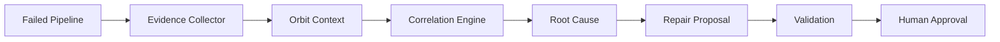

# Orbit Guardian

Context-aware pipeline failure investigation and safe repair.

Orbit Guardian investigates a failed CI pipeline by correlating the job log with GitLab Orbit context, then proposes a small repair. It does not silently edit production code, push, or merge.

## Problem

A failed pipeline rarely includes the context a developer needs. The log shows a compiler error, but not which merge request changed the contract, which work item asked for that change, or who authored it. Reading the log alone produces a guess. Understanding the failure requires the software-delivery context around the code.

## Solution

Orbit Guardian is a supervised investigation workflow:

1. Read the failed pipeline and the failed job log.
2. Collect structured evidence from that log.
3. Query GitLab Orbit for project, code, merge request, work item, and ownership context.
4. Correlate those records with the failing file.
5. State a root-cause hypothesis only when the records agree.
6. Propose a one-expression repair and validate it.
7. Write `reports/latest-investigation.md`.
8. Change a file only when the operator passes `--apply`.

The offline demo uses a deterministic fixture. It does not pretend that an external model or a live Orbit cluster ran.

## Why GitLab Orbit?

GitLab Orbit is a queryable graph of the software-development lifecycle: code, merge requests, work items, pipelines, and the relationships between them. Orbit Guardian uses the documented entity context endpoint, `POST /api/v4/orbit/context`, so a failed job can be connected to the merge request and linked work item instead of treating the log as an isolated text prompt. Engineers can also query Orbit with `glab orbit`. This project does not invent graph edges that the API did not return.

## Architecture



`OrbitClient` is the boundary. `MockOrbitClient` serves the demo. `GitlabOrbitClient` calls GitLab when `--live` is set. The agent does not change when the adapter changes.

## Agent workflow

```text
FAILED PIPELINE
      ↓
COLLECT FAILURE EVIDENCE
      ↓
QUERY ORBIT CONTEXT
      ↓
CORRELATE CODE + MR + PROJECT CONTEXT
      ↓
ROOT-CAUSE HYPOTHESIS
      ↓
PROPOSE REPAIR
      ↓
VALIDATE
      ↓
GENERATE EVIDENCE REPORT
      ↓
HUMAN APPROVAL
```

The CLI prints the same sequence as `[1/7]` through `[7/7]`.

## Supervised autonomy

The demo failure is a TypeScript contract mismatch. Pipeline #184 fails because `src/services/user-service.ts` still reads `user.profile.name`. Merge request !42, “Refactor user profile API,” and work item #91, “Update profile response contract,” describe `displayName`. The proposed repair replaces that one expression. Confidence is high only when the log, the changed file, and the linked work item agree.

## Safety

- Default mode is read-only.
- `--apply` is required before the fixture file is written.
- The only allowed write is `src/fixtures/failing-project/src/services/user-service.ts`.
- Paths outside that fixture are rejected.
- `--create-mr` does nothing unless `--live` and `--source-branch` are also set. The command never pushes and never merges.
- `npm run guardian -- demo` does not read `GITLAB_TOKEN`.

## Local demo

```bash
npm install
npm test
npm run build
npm run guardian -- demo
```

The demo resets the fixture, investigates pipeline #184, and writes `reports/latest-investigation.md`. No credentials are required.

To write the repair and re-check it:

```bash
npm run guardian -- investigate --apply
npm run guardian -- reset
```

`investigate` and `demo` restore the broken fixture first, so the scenario stays repeatable.

## GitLab configuration

Copy `.env.example` to `.env` only on your machine. Do not commit `.env`.

```bash
GITLAB_URL=https://gitlab.com
GITLAB_TOKEN=
GITLAB_PROJECT_ID=
```

Live investigation:

```bash
npm run guardian -- investigate --live --pipeline 184
```

If those variables are missing, live mode stops. It does not silently switch to the mock.

Opening a merge request for an existing branch is a separate, explicit action:

```bash
npm run guardian -- investigate --live --apply --create-mr --source-branch your-branch
```

## Real Orbit integration

| Mode | What runs | Network |
| --- | --- | --- |
| `demo`, `investigate` | `MockPipelineClient` and `MockOrbitClient` | None |
| `--live` | GitLab REST for pipelines, jobs, and job traces. `POST /api/v4/orbit/context` for the job URL, then the linked merge request token when Orbit returns one. | GitLab only |

The live client reads documented summary fields: job name and pipeline, merge request title, author, changed files, and linked issues. It does not invent a security finding when the summary has none. Graph query text (`POST /api/v4/orbit/query`, `glab orbit query`) is available in Orbit and is not called by this MVP; entity context is the call that connects one failed job to its merge request.

Job context uses the job `web_url` when GitLab returns one, because a job URL is a documented Orbit token. `Job[id]` is sent only as a fallback and is the global database id, which may differ from the project job id. A `not_found` response is reported as-is.

## Testing

```bash
npm test
npm run build
```

`npm run build` is strict TypeScript checking. Tests cover log parsing, evidence, Orbit correlation, root cause, the patch, path safety, validation, the report, and the live-mode refusal to use mock data.

## Project structure

```text
src/agent/        investigation, repair, and the seven-step plan
src/orbit/        OrbitClient, live context client, mock client
src/gitlab/       read-only REST client, pipelines, merge requests
src/analysis/     log parsing, evidence, root cause
src/validation/   contract checks and fixture typecheck
src/reports/      Markdown report
src/cli/          demo and investigate commands
src/fixtures/     deterministic failing project
tests/            Vitest
docs/             architecture, demo script, evaluation notes
```

## Limitations

- The reliable demo is the fixture, not a live GitLab group.
- Live mode needs a GitLab token that can read the project and Orbit. This repository does not include hackathon group access.
- The repair strategy is the profile-contract mismatch in the fixture. It is not a general code-writing agent.
- Security findings are reported only when a context summary includes them. The mock scenario has none.
- Publishing the flow in the GitLab AI Catalog is a GitLab UI step and is not performed from this CLI.

## Future work

- Call `POST /api/v4/orbit/query` when a job summary is not enough to find callers.
- Publish the supervised flow to the AI Catalog after the hackathon project exists.
- Support more than one compiler diagnostic without widening what `--apply` is allowed to edit.
