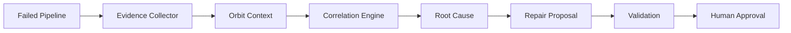

# Architecture

Orbit Guardian is a local TypeScript workflow with two adapters behind one `OrbitClient` interface.

## Components

| Piece | Role |
| --- | --- |
| `MockPipelineClient` | Returns pipeline #184 and the fixture job log. |
| `GitlabPipelineClient` | `GET /projects/:id/pipelines`, jobs, and `jobs/:id/trace`. |
| `MockOrbitClient` | Returns project, files, MR !42, work item #91, and the MR author. |
| `GitlabOrbitClient` | `POST /api/v4/orbit/context` with `expand: true`. |
| `correlate` | Joins the failing path to changed files and linked work items. |
| `determineRootCause` | High confidence only when the log, MR, and work item agree. |
| `proposeRepair` / `applyRepair` | One textual replacement, gated by path checks and `--apply`. |
| `validateProposal` | Two contract checks plus `tsc --noEmit` on a temporary copy. |

## Why context is required

The compiler suggestion `displayName` is not, by itself, a reason to edit the file. The root-cause step also requires the merge request to have touched that file and the linked work item or MR text to mention the replacement field. A log without that Orbit context produces low confidence and no patch.

## Catalog

The workflow is a candidate for a GitLab AI Catalog flow: a pipeline failure trigger, an investigation step that calls Orbit, and a human-approval step before any edit. This repository does not ship a guessed catalog YAML. Create the flow in the GitLab UI or flow builder from `docs/demo-script.md`, then publish it from the hackathon project. The CLI remains the executable demo.
